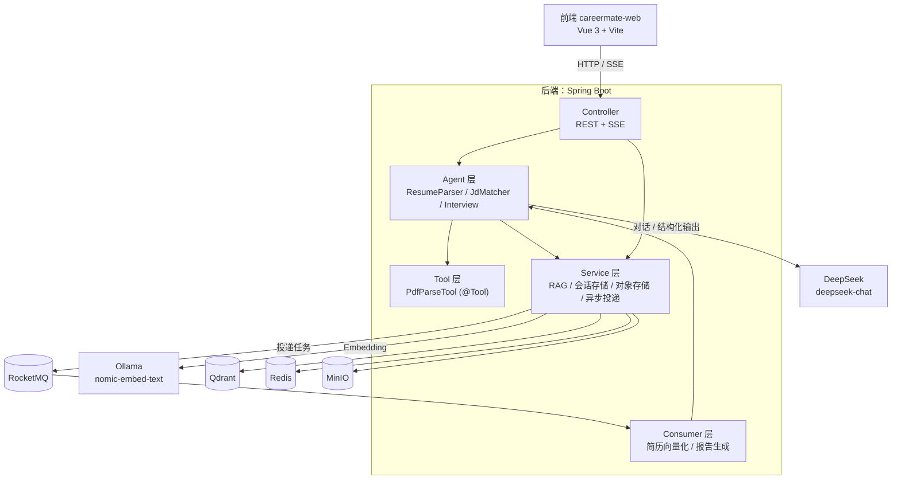

# CareerMate

> 一个 AI 求职智能体：上传简历 PDF → 解析成结构化画像 → 对比目标 JD 给出匹配诊断 → 进行一场会被当场挑刺的模拟面试 → 输出评估报告。

项目分两个代码库：

| 仓库 | 内容 |
|---|---|
| `careermate`（本仓库） | Spring Boot 后端：Agent、RAG、异步任务、REST/SSE 接口 |
| `careermate-web` | Vue 3 前端：简历上传、JD 匹配、流式面试、报告展示 |

---

## 它解决的问题

求职过程中有三件事很耗时，而且做不好自己往往察觉不到：

1. **简历写了什么，和你以为它写了什么，常常不一致。** 本项目的解析是结构化的，字段缺了就是缺了，而不是"模型帮你补全"。
2. **"我和这个岗位差多少"很难自评。** 这里不是关键词匹配，而是让模型逐条比对技能交集与经验要求，并明确列出**缺口**。
3. **面试前没人挑你的刺。** 模拟面试的提示词要求面试官"当场指出错在哪里"，并在最后给出分维度评分与减分项。

---

## 技术栈

| 层 | 选型 | 说明 |
|---|---|---|
| 语言/框架 | Java 17 · Spring Boot 3.5.6 · Maven | |
| AI 框架 | Spring AI 1.1.3（BOM 管理） | |
| 对话模型 | DeepSeek `deepseek-chat` | 通过 OpenAI 兼容协议接入 |
| Embedding | Ollama `nomic-embed-text`（768 维） | 本地运行，DeepSeek 不提供 Embedding |
| 向量库 | Qdrant 1.13.0（gRPC 6334） | |
| 关系库 | MySQL 8.0 | 目前仅用于连通性自检，尚无业务表 |
| 缓存/会话 | Redis 7 | 对话记忆、面试会话与流水、报告缓存 |
| 对象存储 | MinIO | 简历原件归档 |
| 消息队列 | RocketMQ 5.3.3 | 简历向量化、报告生成异步化 |
| PDF 解析 | Apache PDFBox 3.0.3 | |

---

## 架构



**关键点**：对话模型和 Embedding 模型来自两个不同的供应商。Spring AI 的自动配置会因为存在多个 `ChatModel` / `EmbeddingModel` 而无法确定用哪个，所以 `EmbeddingConfig` 用 `@Primary` 显式指定，同时在 `application.yml` 里用 `openai.embedding.enabled=false` 和 `ollama.chat.enabled=false` 做双向互斥。

---

## 目录结构

```
src/main/java/com/github/yu520/careermate/
├── agent/          # 三个 Agent：简历解析 / JD 匹配 / 模拟面试
├── tools/          # Tool Calling 工具：PDF 文本提取
├── service/        # RAG、面试会话、对象存储、异步投递与消费
├── controller/     # REST / SSE 接口
├── model/          # 全部为 Java Record
├── config/         # 模型装配、MinIO 客户端
└── CareermateApplication.java

src/main/resources/
├── application.yml
├── interview-questions.md   # 面试题库（31 条）
└── industry-jd.md           # 行业 JD 样本（8 个岗位）
```

---

## 快速开始

### 1. 前置依赖

必须全部就绪，否则 `/health` 会有红项：

| 组件 | 默认地址 | 启动方式 |
|---|---|---|
| MySQL | 3306 | 建议注册为 Windows 服务 |
| Redis | 6379 | 同上 |
| Ollama | 11434 | `ollama serve`；需先 `ollama pull nomic-embed-text` |
| Qdrant | 6333 / 6334 | `qdrant.exe` |
| MinIO | 9090（API）/ 9000（Console） | `minio.exe server <data> --address ":9090" --console-address ":9000"` |
| RocketMQ | 9876 / 10911 | `mqnamesrv.cmd` + `mqbroker.cmd` |

> **注意 MinIO 的端口**：本项目把 API 放在 9090、Console 放在 9000，与 MinIO 默认相反。`application.yml` 里的 `minio.endpoint` 必须与 `--address` 一致。

### 2. RocketMQ 需要预建 topic

消费者在应用启动时就会订阅，topic 不存在会导致消费者容器启动失败。建议先建好：

```powershell
cd $env:ROCKETMQ_HOME\bin
.\mqadmin.cmd updateTopic -n 127.0.0.1:9876 -b 127.0.0.1:10911 -t careermate-resume-vectorize
.\mqadmin.cmd updateTopic -n 127.0.0.1:9876 -b 127.0.0.1:10911 -t careermate-interview-report
.\mqadmin.cmd updateTopic -n 127.0.0.1:9876 -b 127.0.0.1:10911 -t health-test   # /health 用
```

> 你文档里可能还配了 `rocketmq.producer.endpoints=127.0.0.1:8081`（Proxy 的 gRPC 端口）。**这个配置项不存在**，会被静默忽略 —— `rocketmq-spring-boot` 的合法配置键里没有 `endpoints`。本项目的 `RocketMQTemplate` 走 remoting 协议直连 NameServer，**Proxy 不需要启动**。

### 3. 环境变量

```powershell
$env:DEEPSEEK_API_KEY = "sk-..."
```

缺少它应用会在解析占位符时直接启动失败。

### 4. 启动

```powershell
# 在项目根目录执行
$env:MAVEN_OPTS = "-Dfile.encoding=UTF-8"
mvn spring-boot:run
```

或先打包再运行（部署时用这个）：

```powershell
mvn package -DskipTests
java -Dfile.encoding=UTF-8 -jar target/careermate-0.0.1-SNAPSHOT.jar
```

> **`-Dfile.encoding=UTF-8` 不是可选项。** 项目用 Java 17，而 Java 18 之前 JVM 的默认字符集取操作系统设置（中文 Windows 上是 GBK）。
> 会话记忆的 Redis 序列化用的是默认字符集，缺了这个参数就会出现「UTF-8 写入、GBK 读回」——
> **中文会话记忆全部乱码，表现为多轮对话失忆，而且不报任何错**。详见「踩过的坑 5」。
> IDEA 用户：在 Run Configuration 的 VM options 里填 `-Dfile.encoding=UTF-8`。

> `-DskipTests` 是必须的：`CareermateApplicationTests` 是 `@SpringBootTest`，会加载完整上下文，缺少 API Key 或任一组件不可用都会让打包失败。

### 5. 验证

先确认六项全绿，再往下走：

```powershell
curl.exe -s --noproxy '*' http://127.0.0.1:8080/health
```

期望：`{"mysql":"OK","redis":"OK","qdrant":"OK","minio":"OK (bucket exists)","deepseek":"OK","rocketmq":"OK (sent)"}`

再确认知识库真的灌进去了（首次启动会自动灌库）：

```powershell
curl.exe -s --noproxy '*' http://127.0.0.1:6333/collections/careermate
# points_count 应为 39（31 道面试题 + 8 个行业 JD）
```

启动日志里应出现：

```
知识文件已灌入向量库：interview-questions.md（31 条）
知识文件已灌入向量库：industry-jd.md（8 条）
知识库灌入完成，本次共 39 条
```

### 6. 运行测试

```powershell
mvn test
```

**27 个测试全部是纯逻辑测试，不需要启动任何外部组件** —— 不需要 API Key、不需要 Ollama、不需要 Qdrant。
它们覆盖的正是"一旦出错就会静默降质"的那几段：Record 的越界收敛、提示词渲染、知识库 Markdown 解析。

> 本项目所在机器使用自定义 Maven 仓库，需要额外传 `-s <settings.xml>`；普通环境直接 `mvn test` 即可。

---

## 接口

| 方法 | 路径 | 说明 |
|---|---|---|
| GET | `/health` | 六个组件的连通性自检 |
| GET | `/api/chat?msg=&sessionId=` | 带记忆的多轮对话（基础能力验证） |
| POST | `/api/resume/upload` | 上传简历 PDF（multipart，字段名 `file`），返回 `ResumeProfile` |
| POST | `/api/jd/match` | 简历 + JD → `JdMatchResult` |
| POST | `/api/interview/start` | 开启面试 → `{ sessionId, firstQuestion }` |
| POST | `/api/interview/chat` | 提交回答，**SSE 流式**返回面试官点评与追问 |
| GET | `/api/interview/{sessionId}/report` | 评估报告（异步两阶段：`GENERATING` → `READY`） |

### 数据模型（全部是 Java Record）

```java
ResumeProfile(name, education, skills[], projects[], strengths[], weaknesses[])
JdMatchResult(matchScore, matchedSkills[], missingSkills[], suggestions[])
InterviewReport(overallScore, dimensions[{dimension, score, comment}], highlights[], risks[], suggestions[], summary)
```

`ResumeProfile` 用**紧凑构造器**把 null 集合归一成空集合，下游不必到处判空；`JdMatchResult` 与 `InterviewReport` 会把越界分数夹到 0-100，因为模型偶尔会返回 120 或 -5。

---

## 设计决策与取舍

这一节是这个项目最值得看的部分 —— 每个功能都对应一个具体问题，而不是"因为流行所以加"。

### 1. 对话用 DeepSeek，Embedding 用 Ollama

**决策**：两个模型来自不同供应商，用 `@Primary` + 双向 `enabled=false` 拆分。

**原因**：DeepSeek 不提供 Embedding 接口。如果强行用同一个供应商，就只能换成别的对话模型。

**代价**：多一个本地服务要维护，且 Ollama 不在线时 RAG 链路整体不可用（已做降级，见第 7 条）。

### 2. 知识库按「一个问答对 = 一个向量文档」切分

**决策**：不按固定字数切，一个面试题（问题 + 答案）就是一个文档。

**原因**：面试题的知识单元本身就是自足的。切细会丢掉答案上下文，切粗会把不同知识域（比如 JVM 和 Redis）混进同一个向量，反而拉低检索精度。

**代价**：知识文件必须严格遵守 `### [分类][标签] 标题` 的格式，写错了会被解析器跳过。

### 3. 文档 id 由「来源 + 标题」派生，而不是随机 UUID

**决策**：`UUID.nameUUIDFromBytes(source + "#" + title)`。

**原因**：应用每次启动都会重新灌库，MQ 又是"至少一次"投递，同一条消息可能被消费多次。确定性 id 让重复写入退化成**覆盖写**，而不是在库里堆出多份重复文档。

### 4. 两类知识用 `source` 元数据隔离检索

**决策**：面试题库和行业 JD 在同一集合里用 `source` 字段区分，检索时加 `filterExpression`。

**原因**：两者都充满技术名词，语义高度相近。不做过滤时，JD 匹配会检索出面试题、出题环节会检索出岗位要求 —— 这种错误非常隐蔽，只会表现为"结果质量差一点"。

### 5. 模拟面试不复用 `MessageChatMemoryAdvisor`

**决策**：面试 Agent 自己构造带角色的多轮消息，完整流水另存 Redis。

**原因**：`ChatMemory` 是**运行时上下文**（有窗口截断，本项目限 20 条），而评估报告需要的是**完整记录**。如果复用记忆 Advisor 当记录，轮次多了之后早期回答会被裁掉，报告就评不全。

**代价**：面试相关的代码要自己管上下文窗口，比复用 Advisor 多写约 50 行。

### 6. 报告生成改为异步，并用 SETNX 防重复投递

**决策**：`GET /report` 首次调用返回 `GENERATING` 并投递 MQ 消息，前端轮询；用 Redis `SETNX` 抢占"生成中"标记。

**原因**：报告要把整场面试流水喂进模型，是纯等待型长任务，同步做会让 HTTP 连接挂十几秒甚至超时。而接口会被轮询，不抢占的话多个并发请求会各自投递一条消息，同一场面试被生成好几份报告。

**代价**：前端需要改成轮询，接口变成两阶段语义。

### 7. 知识库灌入失败不阻断启动

**决策**：`KnowledgeBaseLoader` 捕获所有异常，只告警。

**原因**：向量库和 Embedding 都是外部依赖。它们不可用时应用仍然要能启动 —— 否则本地 Ollama 一没开，整个后端连不上，连 `/health` 都用不了，根本没法排查问题。

**代价**：灌库失败是静默的，只能看日志或查 Qdrant 点数才能发现。

### 8. 消费者可以被开关关掉

**决策**：`careermate.async.mq-enabled`（默认 `true`）。

**原因**：这是踩坑后加的。RocketMQ 消费者容器是在 context 刷新末期启动的，一旦连不上 NameServer，`RemotingConnectException` 会向上冒泡成 `ApplicationContextException`，**导致整个应用启动失败** —— 与第 7 条的原则自相矛盾。加开关后，只想调接口时可跳过 MQ。

### 9. `server.error.include-message: always`

**决策**：把 `ResponseStatusException` 的 reason 带进错误响应体。

**原因**：Spring Boot 3 默认 `never`，前端只能拿到 `{status:400, error:"Bad Request", path:"..."}`。Controller 里那些中文说明会被整段丢掉，用户看到的错误信息等于“请求失败”，无法自查。

**代价**：生产环境可能泄露内部细节，届时改成 `on_param`。

---

## 踩过的坑

### 1. `-D` 参数会被 `.cmd` 吞掉

`mvn.cmd -Dmaven.repo.local=D:\repo` 会被 Maven 报成 `Unknown lifecycle phase ".repo.local=D"` —— `-Dmaven` 那半截消失了。**规律是：`-D` 到第一个点之间的内容被吃掉。** 不带点的 `-DskipTests` 则正常。

规避：给 Maven 传系统属性时改用 `MAVEN_ARGS` 环境变量，或干脆避免在命令行传 `-D`。

### 2. 消费者容器启动失败会导致整个应用起不来

见"设计决策 8"。现象是启动日志里 `Started container failed`，然后 `ApplicationContextException`，进程退出。

### 3. PDF 的字体缺少 ToUnicode 映射表

**现象**：一份看起来完全正常的简历，Agent 返回的 `name` 和 `education` 是空的。

**根因**：这份 PDF 用了 5 个字体，其中 3 个没有 `/ToUnicode` 表，也没有 `/Encoding`。PDF 里存的是字形编号而非字符，任何文本提取工具（不只是 PDFBox）都会整段丢弃。

**修法**：用 Word/WPS 的「打印 → Microsoft Print to PDF」重新导出，而不是「导出为 PDF」。快速验证方法：用 PDF 阅读器试着用鼠标选中姓名，**选不中就说明所有解析器都读不到**。

### 4. Vite 默认只绑 `localhost`

在 Windows 上 `localhost` 解析到 IPv6 的 `::1`，导致用 `127.0.0.1:5173` 访问不到开发服务器。排查时容易被误判成"前端没起来"。

### 5. 会话记忆静默乱码：Java 17 的默认字符集是 GBK

**现象**：`/api/chat` 用同一个 sessionId 连问两轮，第二轮完全不记得第一轮说过什么。日志没有任何报错，Redis 里 key 也确实写进去了。

**排查路径**（每一步都排除了一个诱人但错误的假设）：

1. Redis 里有 key → 写入是通的
2. 加临时端点直接调 `ChatMemory.get(sessionId)` → 读出 4 条消息 → 存储与读取都正常
3. 加一个 order 晚于记忆 Advisor 的捕获器，看注入后的 prompt → 历史确实被注入了
4. 直连 DeepSeek API 发同样三条消息 → 回答正确 → **不是模型的问题**
5. 本地起一个假端点做抓包，看真实的出站请求体 → **结构全对，但历史消息的内容是乱码，新消息却正常**

**根因**：`LettuceRedisChatMemoryRepository` 内部用 `RedisTemplate` 的默认字符串序列化，字符集取的是 `Charset.defaultCharset()`。Java 18 才把默认字符集改成 UTF-8，**Java 17 在中文 Windows 上仍然是 GBK**。于是中文按 UTF-8 写进 Redis、按 GBK 读回来，全部变成 `?`。因为只是"内容坏了"而不是"流程错了"，所以没有任何异常抛出。

**修法**：启动加 `-Dfile.encoding=UTF-8`（`ops/start-all.ps1` 与 IDEA 运行配置都已带上），并在 `AiConfig` 里加了一道字符集护栏 —— 默认字符集不是 UTF-8 就打 ERROR 并直接给出修复命令。

**教训**：中文 + Redis + 序列化是经典组合坑，但这次它伪装成了"多轮记忆功能没实现"。**能跑通 ≠ 数据是对的** —— 如果当初只用"接口返回了内容"来验收，这个 bug 会一直留到线上。

---

## 已知限制

- **不支持扫描件 / 图片型 PDF**。PDFBox 只能抽文本层的文字，扫描件需要 OCR（未接入）。`PdfParseTool` 会明确返回"可能是扫描件"的提示，而不是假设简历为空。
- **简历不落库**。`/api/jd/match` 与 `/api/interview/start` 需要客户端把完整的 `ResumeProfile` 回传。一旦加简历持久化，改成传 `resumeId` 即可，Agent 侧不用改。
- **无鉴权、无限流**。接口对外开放，任何人都能直接调用并消耗 API 额度。
- **测试覆盖有限**。已有 27 个单元测试，但只覆盖**纯逻辑**部分（Record 的越界收敛、提示词渲染、知识库 Markdown 解析）。需要真实模型与外部组件的路径（Agent 调用、RAG 检索、SSE 流式）仍未自动化测试。
- **MySQL 尚无业务表**，只在 `/health` 里做连通性自检。
- **简历向量化目前没有消费端**。消费者与幂等设计已就绪，但没有"按简历语义检索"的接口。
- **模型输出有波动性**。同一简历 + 同一 JD 跑两次，`matchScore` 与 `suggestions` 会浮动。这是"让模型判断"的固有代价，不是缺陷；若要稳定，应把评分拆成可验证的子项（技能交集用规则算），只让模型写建议。

---

## 二期计划

1. **简历持久化**：MySQL 存 `ResumeProfile` 与报告，接口改传 `resumeId`
2. **鉴权与配额**：JWT + 用户表 + 按天限额
3. **OCR 兜底**：文本抽取质量低于阈值时降级到 OCR
4. **扩大测试覆盖**：RAG 检索、会话存储往返、SSE 帧解析 —— 这几处需要 mock 外部依赖或引入 Testcontainers
5. **统一异常处理**：`@RestControllerAdvice` + 业务错误码

---

## 前端

见同级目录 `careermate-web`。开发时通过 Vite 代理转发 `/api` 与 `/health` 到 8080，因此后端不需要任何 CORS 配置。
